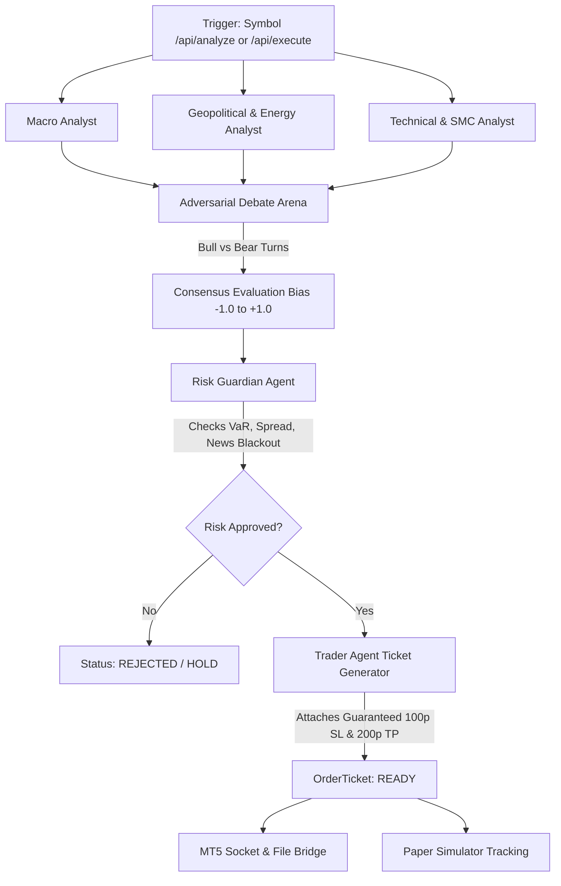

# FEF TRADING AGENT — System Architecture, Codebase & Supervision Dossier

> **Confidential & Comprehensive Project Specification**  
> **Prepared for:** Gemini / AI Supervisor & Development Team  
> **Project Name:** `FEF TRADING AGENT`  
> **Version:** 2.4.0 (Autonomous Institutional Multi-Agent Framework)  
> **Target Asset Universe:** Strictly **Forex & Commodities** (`XAU/USD`, `US Oil WTI`, `EUR/USD`, `GBP/USD`, `USD/JPY`)  
> **Workspace Root:** `/Users/mac/Documents/antigravity/nifty-salk`  
> **Runtime Environment:** Python 3.14+, MetaTrader 5 (macOS Wine / Exness Demo), Modern Web Standards (HTML5 / Tailwind CSS / TradingView Canvas / Web Audio API)

---

## 1. Executive Summary & Core Mission

**FEF TRADING AGENT** is an institutional-grade, multi-agent algorithmic trading and decision-support system designed to trade and analyze Commodities and Major Foreign Exchange pairs.

Unlike conventional single-bot strategies, FEF TRADING AGENT uses a **Society of Specialized AI Agents** that debate macroeconomic data, geopolitical inventory shocks, and Smart Money Concepts (SMC) technical structures before arriving at an adversarial consensus. 

### Key High-Level Capabilities
1. **Multi-Agent Adversarial Debate:** Independent agents (Macro, Geopolitical, Technical, Bull Analyst, Bear Analyst, Risk Guardian) deliberate on market conditions, quantify confidence, and vote on execution.
2. **Guaranteed 100-Pip Stop Loss Rule:** Every trade executed (whether AI-driven or manually triggered) is strictly attached to an automatic **100-pip Stop Loss** and **200-pip Take Profit** (1:2 Risk/Reward).
3. **Dual Execution Engine:**
   - **MetaTrader 5 Universal Dual Bridge (Socket TCP 5555 + UTF-16 Common Files):** Interacts directly with a live or demo MT5 terminal running on macOS Wine.
   - **Paper Trading Simulation Engine:** Real-time in-memory execution mirror that calculates tick-by-tick floating P&L, auto SL/TP triggers, account equity, and margin requirements.
4. **3D Holographic Command Deck:** A cyberpunk-inspired cockpit dashboard featuring TradingView real multi-timeframe candlestick charting (1m, 3m, 5m, 15m, 30m, 1h, 4h, 1D), real-time order execution, Dollar-Risk sizing chips, Web Audio sound effects, and speech synthesis announcements.

---

## 2. Target Instruments & Precision Specifications

The system is strictly hardcoded to 5 global macro instruments defined in `backend/config.py`:

| Symbol | Display Name | Category | Contract Size | Pip Size | Tick Value / Pip / 1.0 Lot | Digits | 100-Pip Risk on 1.0 Lot |
| :--- | :--- | :--- | :--- | :--- | :--- | :--- | :--- |
| **`XAUUSD`** | Gold Spot / US Dollar | Commodity Spot | 100 oz | `0.10` ($0.10/oz) | **$10.00** | 2 | **$1,000.00** |
| **`USOIL`** | US WTI Crude Oil | Energy Future/CFD | 1,000 bbl | `0.01` ($0.01/bbl) | **$10.00** | 2 | **$1,000.00** |
| **`EURUSD`** | Euro / US Dollar | Major FX | 100,000 | `0.0001` | **$10.00** | 5 | **$1,000.00** |
| **`GBPUSD`** | British Pound / USD | Major FX | 100,000 | `0.0001` | **$10.00** | 5 | **$1,000.00** |
| **`USDJPY`** | US Dollar / Japanese Yen | Major FX | 100,000 | `0.01` | **~$6.80** *(variable)* | 3 | **~$680.00** |

---

## 3. Directory & File Structure

```text
nifty-salk/
├── backend/
│   ├── __init__.py
│   ├── config.py                 # System parameters, instruments specs, 100p default SL
│   ├── server.py                 # Multi-threaded API Gateway, REST endpoints, static files
│   ├── agents/
│   │   ├── __init__.py
│   │   ├── macro_analyst.py      # Central bank interest rates, DXY, inflation, yield curve
│   │   ├── commodity_analyst.py  # Energy inventory (EIA), OPEC+ quotas, geopolitical risk
│   │   ├── technical_analyst.py  # SMC order blocks, Fair Value Gaps (FVG), RSI, ATR, 100p SL
│   │   ├── debate_engine.py      # Adversarial Bull vs Bear multi-turn dialogue & consensus
│   │   ├── risk_guardian.py      # VaR, maximum spread filter, exposure ceiling, news blackout
│   │   └── trader_agent.py       # OrderTicket synthesis, manual lot override, SL/TP calculus
│   ├── graph/
│   │   ├── __init__.py
│   │   └── trading_graph.py      # Pipeline coordinator, audit trail logger, ticket dispatch
│   ├── data/
│   │   ├── __init__.py
│   │   ├── market_feed.py        # Live Bid/Ask streaming with realistic spread & volatility
│   │   ├── macro_feed.py         # Global macroeconomic data provider
│   │   ├── economic_calendar.py  # High-impact news event tracker & blackout countdown
│   │   ├── public_apis.py        # Public institutional feeds (ECB, FRED 10Y, EIA, Sentiment)
│   │   └── quote_store.py        # MT5 live quote storage & UTF-16LE BOM decoder
│   └── execution/
│       ├── __init__.py
│       ├── paper_simulator.py    # Local paper broker, floating PnL, Break-Even, Close-All
│       └── mt5_socket_bridge.py  # TCP Port 5555 socket listener + Common Files bridge
├── frontend/
│   ├── index.html                # 3D Parallax Command Deck UI, Audio Synth, Hotkeys, TradingView
│   └── assets/                   # Futuristic cockpit background & visual assets
├── mql5/
│   └── FEF_TradingAgentsBridge.mq5 # MetaTrader 5 Expert Advisor (Quotes out, Orders in)
├── tests/
│   ├── test_pip_calculations.py # Pip values, contract sizing, tick values
│   ├── test_risk_guardian.py    # News blackout, spread limits, portfolio exposure
│   ├── test_debate_graph.py     # Graph pipeline, consensus score thresholds
│   ├── test_public_apis.py      # Public data feed hubs (ECB, FRED, EIA, Sentiment)
│   └── test_quick_execution.py  # 100-pip SL, 200-pip TP, Break-Even, Close-All tests
├── PROJECT_SUPERVISION_BRIEF.md # This specification document
├── requirements.txt             # Minimal zero-bloat dependencies
└── README.md                    # Project documentation
```

---

## 4. Multi-Agent Reasoning Architecture

Every decision pipeline runs through an orchestrated directed acyclic workflow (`backend/graph/trading_graph.py`):



### Agent Roles & Operational Rules:
1. **Central Bank & Macro Analyst (`macro_analyst.py`):**
   - Monitors Federal Reserve (5.25-5.50%), ECB (3.75%), BOE (5.00%), and BOJ (0.25%).
   - Assesses US Dollar Index (DXY) trends and US 10-Year Treasury yield differentials.
2. **Geopolitical & Energy Analyst (`commodity_analyst.py`):**
   - Tracks crude inventory builds/draws (EIA), Cushing storage capacity, and geopolitical risk premia in the Persian Gulf and Red Sea.
3. **Technical & SMC Analyst (`technical_analyst.py`):**
   - Implements Smart Money Concepts: identifies institutional Fair Value Gaps (FVG), Bullish/Bearish Order Blocks (OB), and Asian session liquidity sweeps.
   - Enforces a fixed `stop_pips = 100.0` and `tp_pips = 200.0` for all asset setups.
4. **Bull vs Bear Debate Arena (`debate_engine.py`):**
   - Generates multi-turn adversarial dialogue between an institutional Bull Portfolio Manager and Bear Risk Specialist.
   - Calculates a consensus score between `-1.0` (Extremely Bearish) and `+1.0` (Extremely Bullish).
5. **Risk Guardian Agent (`risk_guardian.py`):**
   - Validates spread sanity (must be below 4.0 pips for Gold, 2.5 for FX).
   - Enforces news blackout windows: trades are blocked if major CPI/NFP releases occur within $\pm15$ minutes.
   - Checks total open portfolio exposure (max 5 simultaneous trades).
6. **Trader Agent (`trader_agent.py`):**
   - Synthesizes all intelligence into a structured `OrderTicket`.
   - Respects user manual lot override (`manual_lot_size`) or defaults to dynamic equity risk sizing (1% risk).
   - Enforces strict 100-pip Stop Loss and 200-pip Take Profit calculation.

---

## 5. Execution Bridge & MetaTrader 5 Integration

### Dual-Bridge Hybrid Architecture
Because MetaTrader 5 runs inside Wine on macOS, direct Python C-extension bindings (`import MetaTrader5`) are unavailable. FEF TRADING AGENT employs an ultra-resilient **Dual Bridge**:
1. **TCP Socket Server (Localhost Port 5555):**
   - Python listens on `0.0.0.0:5555`.
   - The MQL5 EA connects via native `SocketCreate()` and `SocketConnect()`, streaming account balance, equity, and tick Bid/Ask data every 100ms.
2. **MetaTrader 5 Common Files Bridge:**
   - Location: `/Users/mac/Library/Application Support/net.metaquotes.wine.metatrader5/drive_c/users/mac/Application Data/MetaQuotes/Terminal/Common/Files/`
   - Telemetry In: `fef_live_quotes.json` (writes balance, equity, bid, ask with UTF-16LE BOM decoding).
   - Telemetry Out: `fef_pending_orders.json` (Python writes execution commands for instant pickup).

### Supported Remote MQL5 Commands
The MQL5 Expert Advisor ([`FEF_TradingAgentsBridge.mq5`](file:///Users/mac/Documents/antigravity/nifty-salk/mql5/FEF_TradingAgentsBridge.mq5)) interprets 3 real-time commands:
1. **`ORDER_SEND`**: Executes `trade.Buy()` or `trade.Sell()` with specified volume, entry, 100-pip SL, and TP.
2. **`ORDER_BREAK_EVEN`**: Scans all active positions on the terminal and adjusts `sl` to open price (`POSITION_PRICE_OPEN`).
3. **`ORDER_CLOSE_ALL`**: Iterates through `PositionsTotal()` backwards and executes `trade.PositionClose(ticket)` on all open orders.

---

## 6. Frontend 3D Command Deck & High-Speed Controls

The frontend is served from `frontend/index.html` on `http://localhost:8000`.

### Core Features Added
1. **Option A — Dual One-Click BUY/SELL & Position Management:**
   - **`[🟢 BUY (100p SL) [B] @ Ask]`**: Instant market BUY with streaming Ask price.
   - **`[🔴 SELL (100p SL) [S] @ Bid]`**: Instant market SELL with streaming Bid price.
   - **`[🛡️ BREAK-EVEN (Space)]`**: Shifts Stop Loss on all open positions to Entry + 1 pip.
   - **`[🚨 CLOSE ALL (X)]`**: 1-Click emergency liquidation of all positions.
2. **Option B — Dollar-Risk Sizing Chips:**
   - Chips: **`[$100]`**, **`[$250]`**, **`[$500]`**, **`[$1,000]`**, **`[0.5%]`**, and **`[1.0%]`**.
   - Formula: $\text{Lot Size} = \frac{\text{Dollar Risk}}{100 \times \text{Tick Value per Lot}}$.
   - Examples for 100-pip SL:
     - Gold / Oil / EUR / GBP: `$100` $\rightarrow$ `0.10L`, `$500` $\rightarrow$ `0.50L`, `$1,000` $\rightarrow$ `1.00L`.
     - USD/JPY: `$500` $\rightarrow$ `0.74L`.
3. **Option C — Pro Keyboard Shortcuts, Synthesizer & Speech Voice:**
   - **Hotkeys:** `B` (Buy), `S` (Sell), `X` (Close All), `Space` (Break-Even), `1`-`5` (Switch Assets).
   - **Zero-Dependency Web Audio Synth:** Procedural chimes for order fills, sweeps for liquidation, and ping pings for break-even. Toggleable via `[🔊 AUDIO ON]`.
   - **AI Speech Synthesis:** Natural audio readout (*"BUY 1.00 Lot Gold executed. 100-pip Stop Loss active at 4420.31"*). Toggleable via `[🗣️ VOICE ON]`.
4. **Interactive Multi-Timeframe Candlestick Chart:**
   - Embedded institutional TradingView widget with resolution buttons: **`1m`**, **`3m`**, **`5m`**, **`15m`**, **`30m`**, **`1h`**, **`4h`**, and **`1D`**.
   - Dual view toggle: **`[REAL CANDLES]`** vs **`[AI SMC]`**.

---

## 7. REST API Reference

| Method | Endpoint | Description | Payload Example / Response |
| :--- | :--- | :--- | :--- |
| **`GET`** | `/api/status` | Account equity, live quotes, MT5 bridge state, public feeds | `{ "account": {...}, "instruments": {...}, "mt5_bridge": {...} }` |
| **`GET`** | `/api/analyze` | Runs full multi-agent debate and returns order ticket | Query: `?symbol=XAUUSD&lot_size=1.0` |
| **`GET`** | `/api/positions` | Returns open positions and account metrics | `{ "positions": [...], "balance": 50000, "equity": 50000 }` |
| **`GET`** | `/api/public-feeds` | Returns live ECB rates, FRED 10Y/DXY, EIA crude, Sentiment | `{ "ecb_rates": {...}, "fred_macro": {...}, ... }` |
| **`POST`** | `/api/quick_execute` | 1-Click BUY/SELL execution with auto 100-pip SL | `{"symbol":"XAUUSD", "action":"BUY", "lot_size":1.0}` |
| **`POST`** | `/api/execute` | Executes AI debate consensus order | `{"symbol":"XAUUSD", "lot_size":1.0}` |
| **`POST`** | `/api/break_even` | Moves SL to Entry + 1 pip across open trades | `{}` $\rightarrow$ `{"status":"SUCCESS", "updated_count": 2}` |
| **`POST`** | `/api/close_all` | Closes all open positions immediately | `{}` $\rightarrow$ `{"status":"SUCCESS", "closed_count": 2}` |
| **`POST`** | `/api/close_position` | Closes individual position by ticket ID | `{"ticket": 1001}` |

---

## 8. Automated Test Suite

The test suite covers full coverage of math, sizing, agents, risk, and execution:

```bash
# Run all unit tests
python3 -m unittest discover tests
```

- [`tests/test_pip_calculations.py`](file:///Users/mac/Documents/antigravity/nifty-salk/tests/test_pip_calculations.py): Validates contract sizes, pip conversions, tick values across all 5 symbols.
- [`tests/test_risk_guardian.py`](file:///Users/mac/Documents/antigravity/nifty-salk/tests/test_risk_guardian.py): Validates spread filters, VaR calculation, and news blackout guards.
- [`tests/test_debate_graph.py`](file:///Users/mac/Documents/antigravity/nifty-salk/tests/test_debate_graph.py): Verifies end-to-end execution of the multi-agent debate workflow.
- [`tests/test_public_apis.py`](file:///Users/mac/Documents/antigravity/nifty-salk/tests/test_public_apis.py): Tests Frankfurter, FRED, EIA, and Sentiment feeds.
- [`tests/test_quick_execution.py`](file:///Users/mac/Documents/antigravity/nifty-salk/tests/test_quick_execution.py): Tests 100-pip SL attachment, Break-Even logic, and Close-All liquidation.

**Result: 18 / 18 Tests Passing.**

---

## 9. Developer & Operational Instructions

### How to Start the System
```bash
# 1. Kill any existing instances on ports 8000 and 5555
lsof -ti :8000 | xargs kill -9 2>/dev/null || true
lsof -ti :5555 | xargs kill -9 2>/dev/null || true

# 2. Launch the backend server daemon
python3 -m backend.server 8000

# 3. Open your browser
# URL: http://localhost:8000
```

### How to Connect MetaTrader 5 (Wine on macOS)
1. Open your MetaTrader 5 terminal (e.g. Exness Demo).
2. Open MetaEditor 5 or compile `FEF_TradingAgentsBridge.mq5`.
3. In MT5: **Tools** $\rightarrow$ **Options** $\rightarrow$ **Expert Advisors**:
   - Check *"Allow Algorithmic Trading"*.
   - Check *"Allow WebRequest for listed URL"* and add `http://localhost:5555` and `http://127.0.0.1:5555`.
4. Attach `FEF_TradingAgentsBridge` to any chart (e.g. `XAUUSD,M15`).
5. On the chart, the comment header will display:
   `FEF TRADING AGENT AI BRIDGE v2.2 - LIVE STREAMING ACTIVE`.

---

## 10. Guidelines for Future Supervision & Enhancements

When providing instructions or asking Gemini / AI developers to add new features to this project, adhere to these strict rules:

1. **Asset Universe Constraint:** Strictly retain only the 5 macro instruments: **XAUUSD**, **USOIL**, **EURUSD**, **GBPUSD**, and **USDJPY**. Do not add random altcoins or equities unless explicitly requested.
2. **The 100-Pip Stop Loss Invariant:** Every order generation pathway (whether manual quick-execute, AI consensus, or MQL5 fallback) **must** enforce `stop_pips = 100.0`.
3. **No Heavy External Dependencies:** Keep the backend lightweight using Python's standard library (`http.server`, `urllib`, `socket`, `threading`, `json`). Avoid introducing heavy async frameworks or microservices that break macOS Wine MT5 bridging.
4. **Audio & UI Reliability:** Any new sound FX must use the browser's native **Web Audio API** (`AudioContext`) to generate procedural tones offline rather than relying on external hosted audio files.
